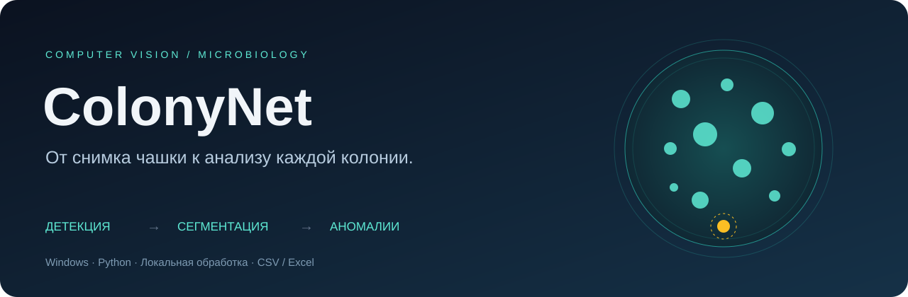
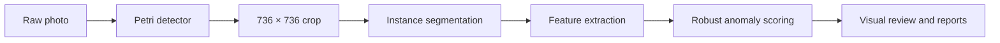
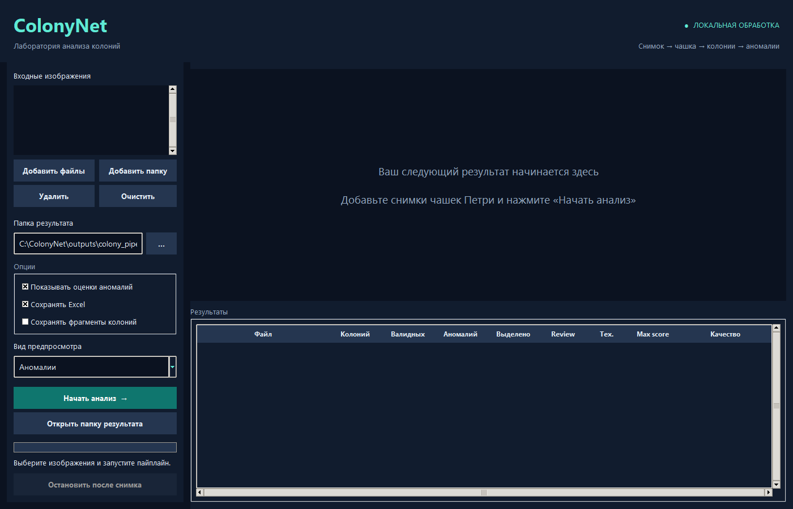

<p align="center">
  
</p>

<p align="center">
  <strong>Local computer vision for Petri-dish colony analysis.</strong><br>
  Detection, instance segmentation, interpretable measurements, and anomaly review in one Windows application.
</p>

<p align="center">
  <a href="https://github.com/ArtemFiend/ColonyNet/actions/workflows/checks.yml"></a>
  
  
  
</p>

> [!IMPORTANT]
> This is a portfolio source snapshot, not a ready-to-run model release. Model weights, datasets, experiment databases, research notebooks, generated reports, and working images are intentionally not included. The application needs two compatible local checkpoints to perform inference.

## Overview

ColonyNet turns a photograph of a Petri dish into a reviewable local report. It locates the dish, segments colony-like objects, measures their morphology and appearance, and ranks objects that differ from their plate context.

| Stage | Output |
| --- | --- |
| Petri-dish detection | Dish bounding box and normalized 736 × 736 crop |
| Colony segmentation | Cleaned, non-overlapping instance masks |
| Feature extraction | Shape, colour, texture, neighbourhood, and mask-quality measurements |
| Anomaly review | Ranked candidates with interpretable evidence and stability checks |
| Reporting | Processing images, CSV tables, and an optional Excel workbook |



The anomaly score is a within-image review priority. It is **not** a calibrated probability, species identification, contamination diagnosis, or antimicrobial-susceptibility result. See the [model card](docs/MODEL_CARD.md) for the intended use and limitations.

## Desktop application

The Windows interface accepts individual images or folders, displays each processing stage, reports progress, and creates a separate directory for every run. Processing can be stopped safely after the current image.

<p align="center">
  
</p>

## Repository scope

Included in this snapshot:

- the Windows desktop application and command-line entry point;
- the complete inference pipeline, including feature extraction, thresholds, anomaly scoring, and review logic;
- packaging configuration, automated safeguards, architecture notes, and a minimal API example.

Not included:

- trained model weights or a model download endpoint;
- training and evaluation datasets;
- notebooks, experiment tracking data, benchmark outputs, or claimed production metrics;
- laboratory images, generated reports, executables, or databases.

Because the checkpoints and evaluation data are private, a fresh clone can run source-level checks but cannot reproduce the model outputs or independently verify model quality. No accuracy claim is made by this repository.

## Quick start

Requirements: Windows, Python 3.10–3.12, and two compatible checkpoints from a trusted source.

```powershell
git clone https://github.com/ArtemFiend/ColonyNet.git
cd ColonyNet
py -3.11 -m venv .venv
.\.venv\Scripts\python.exe -m pip install --upgrade pip
.\.venv\Scripts\python.exe -m pip install -e .
```

Place the checkpoints in `src/colonynet/models/`:

| Expected filename | SHA-256 of the checkpoints used for local validation |
| --- | --- |
| `petri_detector_yolo26s_best.pt` | `adc76b3226de7f219d8da9a3afecd45d9d4729b80ce6e44a9f99341d5108223f` |
| `colony_yolo26x_seg_best.pt` | `4aa01bb1c43c1484820c22faafbfa5553cc255c3813595beee887a787f67e2f5` |

The hashes identify the private files used during local validation; they are not download links. PyTorch checkpoints can contain executable objects, so never load an untrusted `.pt` file.

```powershell
# Check the installation and model files
.\.venv\Scripts\python.exe -m colonynet --self-test

# Open the desktop application
.\run.ps1

# Process one image without the GUI
.\.venv\Scripts\python.exe -m colonynet --run-once "plate.jpg" --output "outputs/demo"
```

PyTorch installation depends on the CPU/CUDA environment. For GPU acceleration, install the matching official PyTorch build before installing ColonyNet. The default dependency set is intentionally broad and is not a frozen reproducibility environment.

## Use as a Python package

```python
from pathlib import Path

from colonynet.pipeline import (
    load_pipeline_models,
    make_full_pipeline_config,
    run_single_image_pipeline,
)

config = make_full_pipeline_config("outputs/example")
segmenter, petri_detector = load_pipeline_models(config)
result = run_single_image_pipeline(
    Path("plate.jpg"), segmenter, config, petri_detector
)

print(f"Detected colonies: {len(result['scores'])}")
print(f"Selected anomalies: {len(result['selected'])}")
```

See [examples/analyze_one.py](examples/analyze_one.py) for the standalone example and [docs/ARCHITECTURE.md](docs/ARCHITECTURE.md) for the processing design.

## Validation

GitHub Actions compiles the source, runs the unit tests available without model weights, and checks the tracked files for common publication mistakes. Run the same checks locally:

```powershell
$env:PYTHONPATH = "src"
.\.venv\Scripts\python.exe -m unittest discover -s tests -v
.\.venv\Scripts\python.exe scripts/check_repository.py
```

The safeguards cover offline import behaviour, output-name collisions, spreadsheet formula injection, empty detections, common credential patterns, and accidental inclusion of large/private artifacts. Tests that require the ML stack are skipped when those dependencies are unavailable. Full inference still requires the private checkpoints and representative input images.

Model and export formats such as `.pt`, `.pth`, `.ckpt`, `.safetensors`, `.onnx`, `.pkl`, `.h5`, and `.engine` are both ignored by Git and rejected by the repository check if they are ever force-added. Keep the public repository on a clean, single-commit history: deleting a file in a later commit does not remove it from earlier Git history.

## Local data handling

Inference runs on the workstation. Before Ultralytics is imported, ColonyNet enables offline mode and disables supported telemetry and experiment-tracking integrations. Reports may contain source pixels, filenames, masks, and derived measurements, so treat the output directory with the same controls as the original images. The exact boundary is documented in [SECURITY.md](SECURITY.md).

## Project structure

```text
src/colonynet/
├── app.py          # Windows UI and CLI
├── pipeline.py     # Detection, segmentation, features, and scoring
├── runtime.py      # Offline defaults and safer file handling
└── models/         # Local checkpoints (ignored by Git)
docs/               # Architecture, limitations, and screenshots
examples/           # Minimal programmatic usage
packaging/          # PyInstaller configuration
scripts/            # Repository publication checks
tests/              # Unit and integration safeguards
```

## Windows build

```powershell
.\.venv\Scripts\python.exe -m pip install pyinstaller
.\build.ps1
.\dist\ColonyNet\ColonyNet.exe --self-test
```

The generated `dist/` directory and embedded checkpoints are excluded from Git.

## License

No open-source license is included at present. Copyright law therefore reserves reuse, modification, and redistribution rights to the author. Add an explicit license before inviting third-party reuse or contributions.
